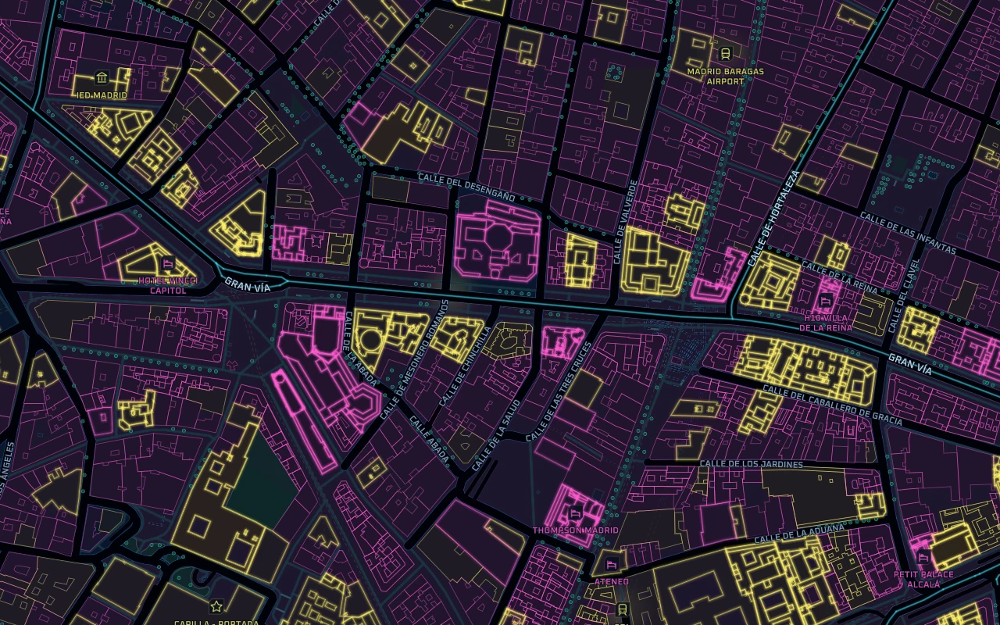

# Cyberpunk

A neon city map with electric blue, magenta and yellow accents, category signs, jade 3D trees
and optional translucent low relief. Designed by Tileflow.

Map data © [OpenStreetMap contributors](https://www.openstreetmap.org/copyright).
Static capture of the `gran-via` scene with flat tree fallback, rendered on 2026-10-18; see [preview provenance](../../THIRD_PARTY_NOTICES.md).

From the repository root, run `npm ci`, then `npm run preview:cyberpunk`.
Edit `tileflow.config.ts` for the camera and overrides or `index.ts` for the map design.
The map uses Tileflow World data and a single `dark` theme. Fonts, icons and patterns are packaged
under `assets/`; font origins and licenses are recorded in `assets/fonts/README.md`.

The map opens with a flat camera and neon footprints. **3D ON** adds translucent relief to all
visible buildings: 32% of their recorded height, bounded to 4–14 metres. This is a stylised relief,
not a representation of real heights. Tilt the camera to about 35° to compare with **3D OFF**.
The jade tree models remain visible in either mode; **Trees** controls them independently.
Static captures retain the 2D view with matching flat tree crowns.
Roads scale with zoom; close views reveal subdued pedestrian surfaces and crossings. Architectural
halos concentrate on prominent buildings. Sector washes distinguish real land uses; station signs
and major destinations appear first, with local businesses entering at closer zooms. Icons, labels
and architecture share destination, commercial and nature colour families.
Core `0.1.0-alpha.35` or newer is required; `npm ci` installs the tested versions in the lockfile.
Zooms 0–5 use a dark ocean, depth shading, coastal light and spaced country labels.
Zooms 3–11 add ranked city markers and progressively introduce the main road network.
Zooms 11–14 bring forward districts, jade parks and a quiet blue local street grid, before
the close-up neon building treatment takes over. City markers fade away by zoom 12.
The `world`, `iberia`, `network`, `regional`, `districts`, `madrid`, `gran-via` and `retiro`
scenes cover the transitions from global geography to street detail.

Exports: `cyberpunk`, `cyberpunkFonts`, `cyberpunkIcons`. Map ID: `cyberpunk`.
The icon/pattern IDs are `cyberpunk-crosswalk`, `cyberpunk-data-grid`,
and `cyberpunk-sign-{transit,medical,hotel,culture,food,shop,park,landmark,place}`.
Building interiors use plain translucent fills,
with luminous contours following their actual geometry. See [artwork notes](assets/README.md).
