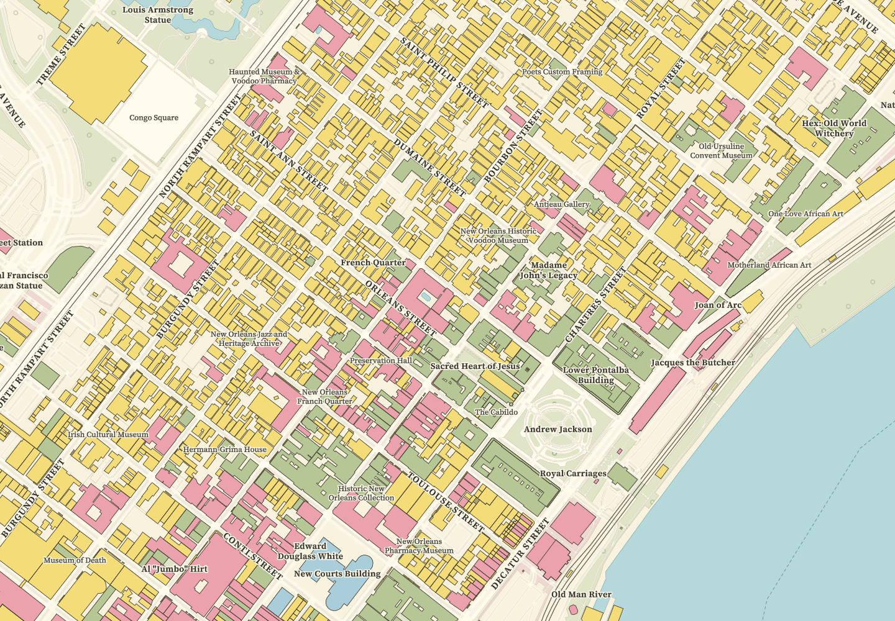

# Sanborn

A flat city atlas with yellow, rose and blue buildings, fine ink outlines, open streets and
clear serif lettering. Inspired by the printed fire insurance maps held by the Library of Congress.
One appearance, `paper`, with no time-of-day variants, terrain or 3D buildings.



Map data © [OpenStreetMap contributors](https://www.openstreetmap.org/copyright), OpenMapTiles
and Tileflow. This preview is a renderer capture of current data, not a historical map.

## Preview and edit

From the repository root:

```sh
npm ci
npm run preview:sanborn
```

The complete design is authored from scratch in `tileflow.config.ts`, using public `@tileflow/core`
modules. It does not import or extend another map. Edit that file to change colours, lettering,
the camera or the six reproducible capture scenes; `assets/` contains this map's own resources.

```sh
npx tileflow capture --config maps/sanborn/tileflow.config.ts --all --out-dir .tileflow/sanborn
npm run build:sanborn
```

## Use in another project

```ts
import {sanborn} from '@tileflow/community-maps';

export default sanborn;
```

The shared export is immutable. Its initial view is the French Quarter in New Orleans.
`sanbornFonts` and `sanbornIcons` are also exported for explicit resource composition.

## Reading the map

Buildings carry the strongest colour. Streets retain clear paper interiors and dark uppercase
names. Principal buildings and places enter before shops and restaurants; POIs are text
annotations, without a second field of pictograms. Local names, collision placement and paper
halos preserve legibility over building outlines. Address numbers appear at detail zooms only
where the selected data supplies them.

The historical Sanborn colours describe construction materials. Tileflow World does not publish
those materials, so this design uses the palette for **mapped building uses**, not material,
fire-resistance or risk claims: yellow for residential or unspecified buildings; rose for
apartments, commerce and lodging; blue for industry and civic uses; green for worship and
destinations; grey for outbuildings. This modern interpretation does not invent parcels, interiors,
storey counts or original sheet numbers. Current geometry is not a reconstruction of a past date.

Sanborn's detailed street-sheet vocabulary is strongest at neighbourhood and building scales.
At regional scales, subdued land-use colours and a simpler road hierarchy preserve orientation.
Packaged fonts cover Latin, Greek and Cyrillic, rather than every writing system worldwide.

## Source and attribution

Original Tileflow code and garden artwork, Apache-2.0. No historical scan, texture, source-map data
or traced legend artwork is bundled. The independent design has no affiliation with the Sanborn
publisher or the Library of Congress.

- [Interpreting Sanborn maps, Library of Congress](https://guides.loc.gov/fire-insurance-maps/sanborn-interpreting)
- [Sanborn symbol key, Library of Congress](https://www.loc.gov/static/collections/sanborn-maps/images/sankey22c.jpg)
- [New Orleans atlas, 1896 volume 1](https://www.loc.gov/item/sanborn03376_005/)
- [Font sources and licences](assets/fonts/README.md)

Geographic data is requested at runtime and is not bundled. Keep its attribution when displaying
the map or the preview. See the package's [complete notices](../../THIRD_PARTY_NOTICES.md).
