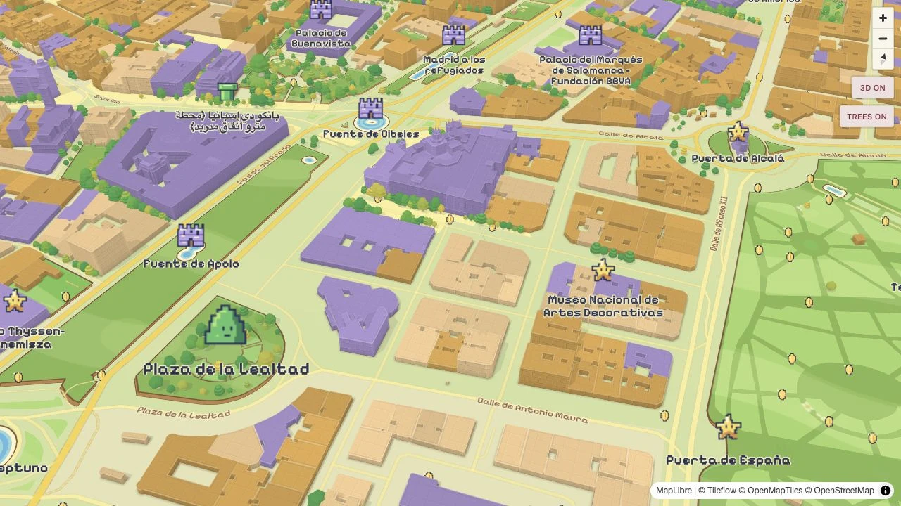

# Super Tile World

A toy-like 3D overworld with striped bells, rounded and layered trees, sunlit buildings, soft lawn bands, cream shores, golden routes,
and arcade lettering. Original Tileflow artwork, inspired by playful platform-game worlds.

Map data © [OpenStreetMap contributors](https://www.openstreetmap.org/copyright).
Captured from the current 3D example scene; see [preview provenance](../../THIRD_PARTY_NOTICES.md).

From the repository root, run `npm ci`, then `npm run preview:super-tile-world`.
Edit `tileflow.config.ts` for the camera and overrides or `index.ts` for the complete design.
The map uses Tileflow World data and a single `light` theme. All sprites, patterns, and fonts are
packaged under `assets/`; [artwork notes](assets/README.md) and
[font provenance](assets/fonts/README.md) accompany them.

Exports: `superTileWorld`, `superTileWorldFonts`, `superTileWorldIcons`, `superTileWorldModels`.
Map ID: `super-tile-world`. Sprite and pattern IDs use the `stw-` prefix.

This independent showcase is not affiliated with Nintendo. Its complete artwork and font
attribution is in [THIRD_PARTY_NOTICES.md](../../THIRD_PARTY_NOTICES.md).

Super Tile World requires Core alpha.40 or newer, including its 3D vegetation and
`buildings.threeDimensional.surfaces` renderer. The exact development dependencies in
`package-lock.json` provide the matching compiler and CLI.
The example opens an angled Madrid scene;
its models render through Tileflow’s 3D scene. Trees follow the geographic tree data and
remain real geometry at overhead pitch. Renderers without 3D vegetation retain the colored
park and forest ground, without falling back to tree sprites.

Ordinary buildings keep their lavender, cream and ochre palette. Their 3D surfaces use large
staggered brick joints, quieter roof tiles and a light cornice band. The joints are drawn by
the renderer, without image textures or separate brick meshes, and fade at a distance.
The cornice is a painted finish; building footprints, heights and courtyards remain unchanged.
Landmark models retain their own materials.

The ground uses broad, low-contrast grass bands, rounded lawn patches and small white/yellow
flower clusters. Cream banks and a turquoise waterline frame the original blue water;
warm strata mark mapped sand and rock. A slightly warmer cream urban base separates streets
and blocks from the parks. These are original seamless SVG patterns, not game textures.
