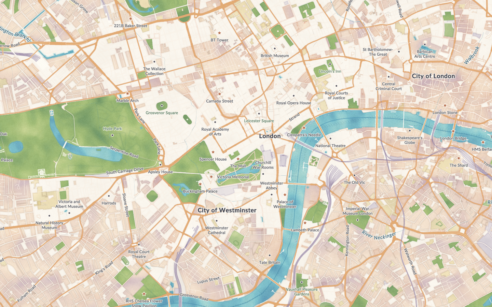

# Watercolor

An independent community map by Tileflow: turquoise water, olive and sap-green washes,
peach urban areas and lavender buildings on warm paper. Soft shores and granular pigment
sit below crisp Lato street names and restrained place markers. One appearance, a globe
when zoomed out and a top-down 2D map when zoomed in.



## Run and edit

```sh
npm ci
npm run preview:watercolor
npm run build:watercolor
```

The complete design is in [`tileflow.config.ts`](tileflow.config.ts). It uses public
`@tileflow/core` APIs and current Tileflow World data. It imports and extends no other map.
`index.ts` only exposes that same definition to package consumers as `watercolor`.
No account or API key is required for local preview; World tiles require network access.

```ts
import {defineMap} from '@tileflow/core';
import {watercolor} from '@tileflow/community-maps';

export default defineMap({
  id: 'painted-city', version: 1, extends: watercolor,
  view: {center: [-0.133, 51.505], zoom: 13.2, pitch: 0},
});
```

The `globe`, `iberia`, `regional` and `landscape` scenes review the world view and gradual
transition from continuous physical cover to detailed land use across zooms 8–11. The
`london`, `detail`, `coast`, `countryside` and `mobile` scenes review street and
POI legibility, urban blocks, parks and open water. The map has no terrain, 3D buildings,
tree models, sky or time-of-day variants. Its camera policy keeps pitch at zero.

## Artwork and attribution

The visual reference is [Stamen Watercolor](https://stamen.com/watercolor-process-3dd5135861fe/),
the 2012 painted-map design. This is an original Tileflow interpretation using current vector
geometry, soft linework and procedural pigment textures. It does not reproduce Stamen's raster
pipeline or redistribute its tiles, code, textures or artwork, and has no affiliation with Stamen.

The six seamless PNG washes and two SVG markers are original artwork under this repository's
Apache-2.0 license. Regenerate the washes with `node maps/watercolor/assets/build-washes.mjs`;
the deterministic Node script needs no extra libraries. Colors are decorative cartography,
not measurements of building materials or risk.

Unmodified Lato Regular, Bold and Italic are licensed under SIL OFL 1.1; see
[`assets/fonts/README.md`](assets/fonts/README.md) and the adjacent complete license.

The preview is a real Tileflow CLI capture of the `london` scene on 2026-11-13,
using the dependency versions in `package-lock.json`. Map data ©
[OpenStreetMap contributors](https://www.openstreetmap.org/copyright), ODbL.
Preserve map-data attribution when displaying it. Geographic tiles are not included.
